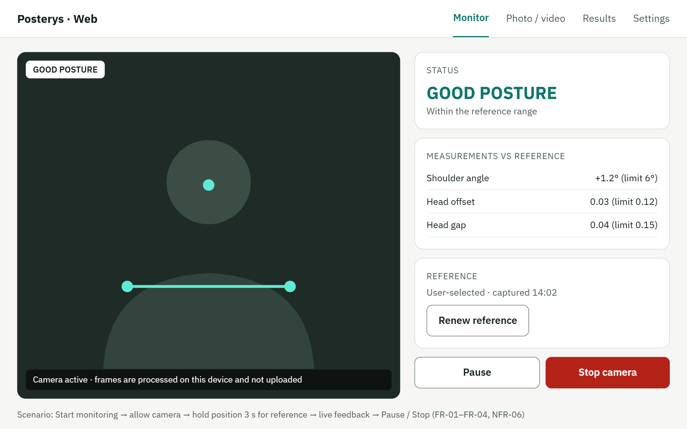
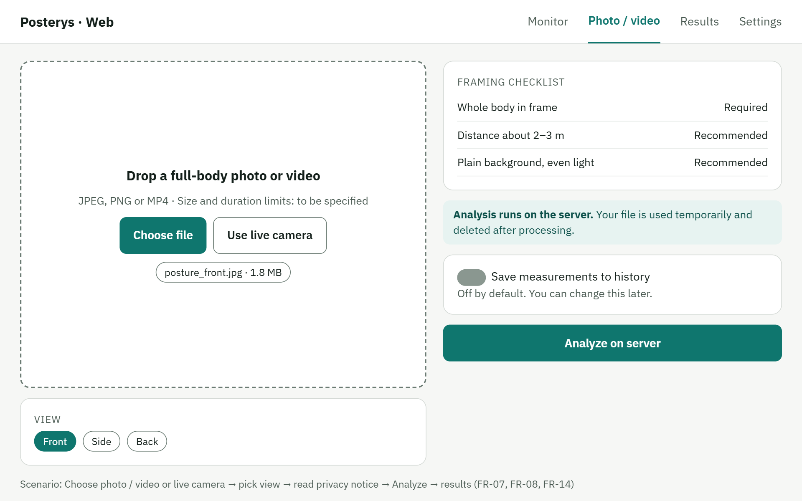
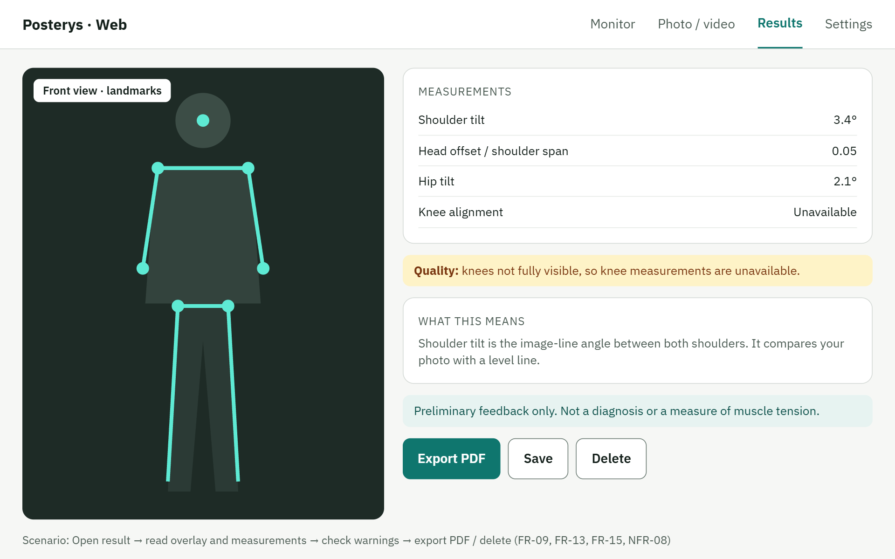
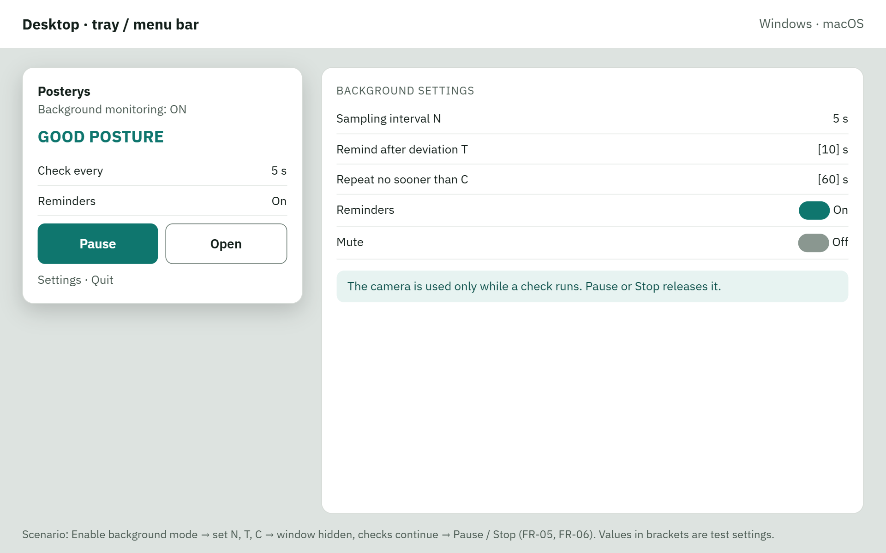
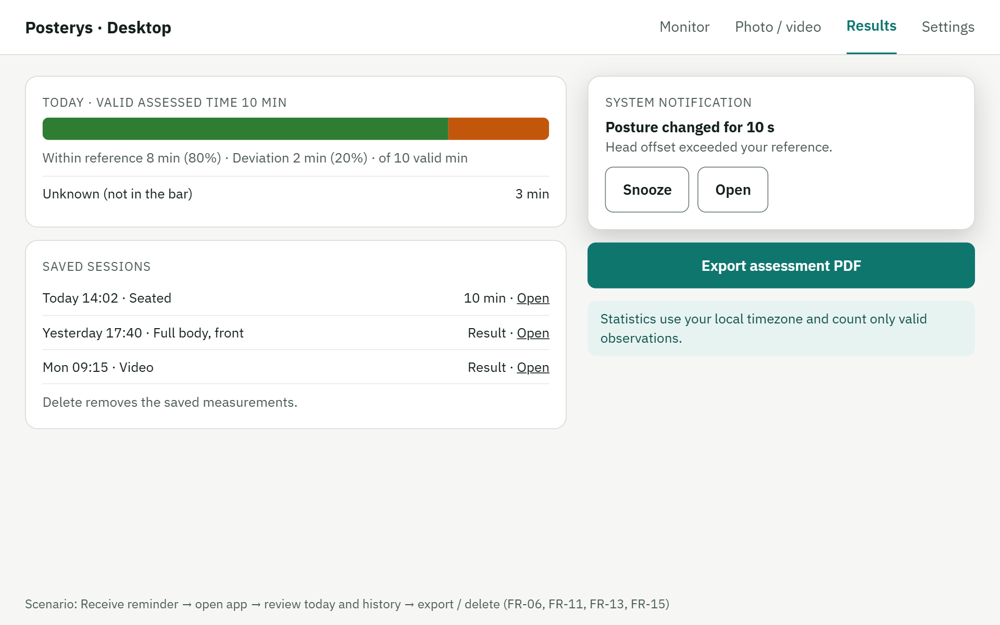

# Posterys UX mockups

Five static UI mockups describe the planned web and desktop workflows.
Displayed measurements and statistics are illustrative.
These images do not demonstrate implemented functionality or passed tests.

| ID    | Screen                            | Requirements                       |
| ----- | --------------------------------- | ---------------------------------- |
| UX-01 | Seated monitoring                 | FR-01–FR-04, FR-14; NFR-06         |
| UX-02 | Full-body assessment              | FR-07, FR-08, FR-14                |
| UX-03 | Assessment results                | FR-09, FR-13, FR-15; NFR-08        |
| UX-04 | Desktop background monitoring     | FR-05, FR-06; NFR-04, NFR-06       |
| UX-05 | Reminders, history and statistics | FR-06, FR-11, FR-13, FR-15; NFR-08 |

## UX-01 — Seated monitoring

## UX-02 — Full-body assessment

## UX-03 — Assessment results

## UX-04 — Desktop background monitoring

## UX-05 — Reminders, history and statistics

## Evaluation status

Design review and usability walkthroughs are pending.
The local Python prototype and its automated tests are documented separately.
